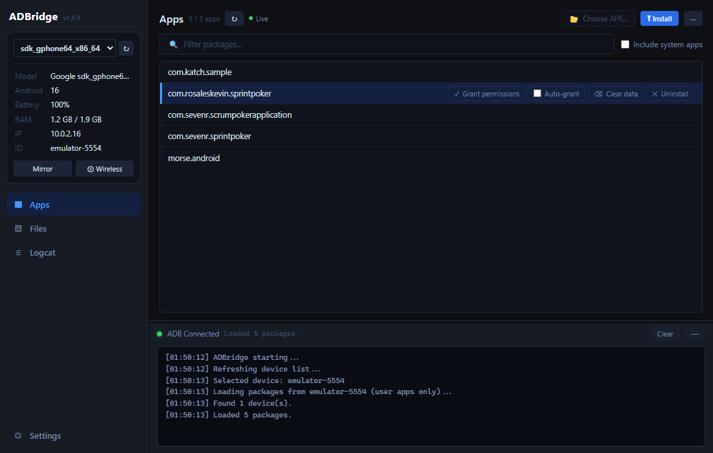
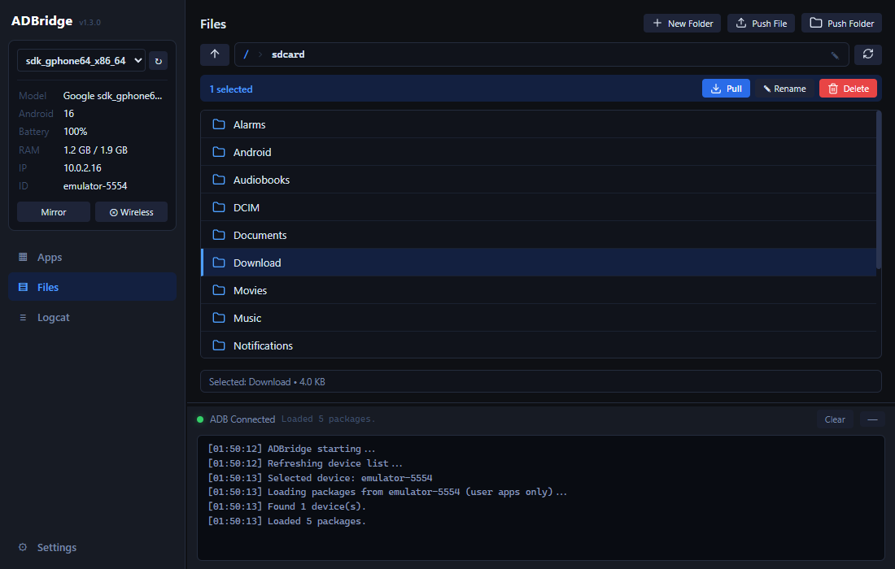
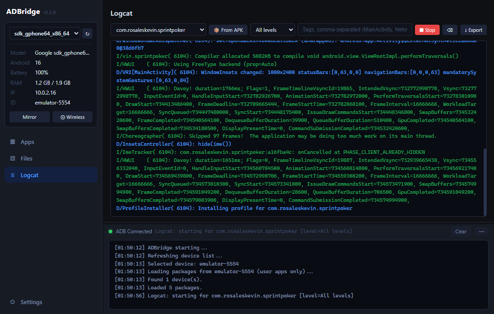
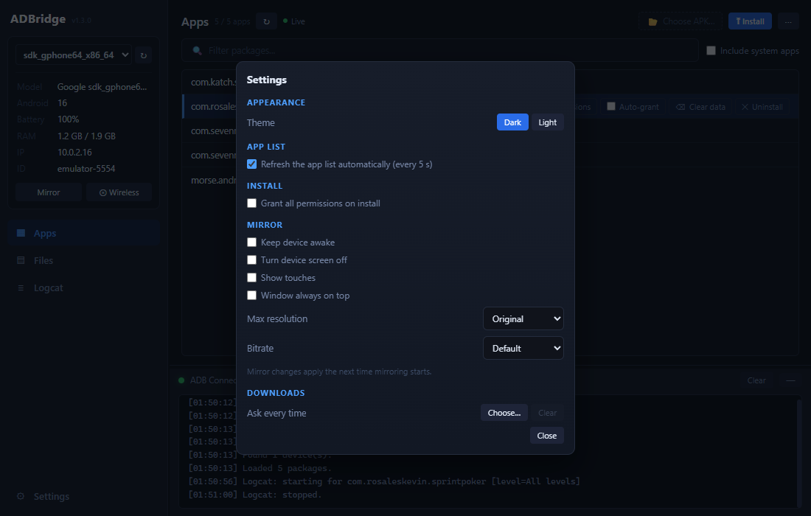
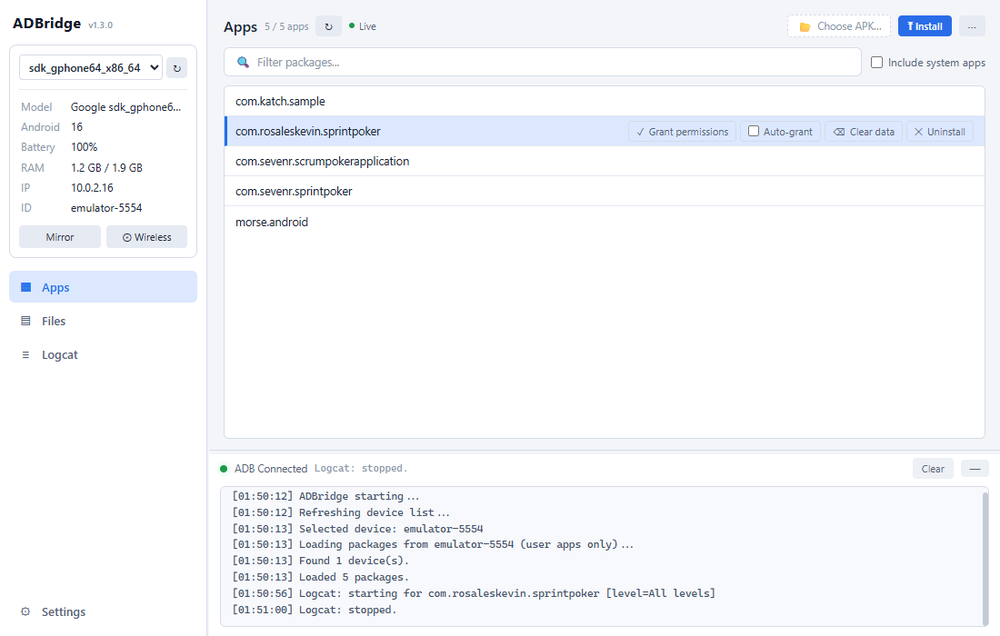

<p align="center"></p>

# ADBridge v1.3.0

ADBridge is the swiss knife of ADB: a desktop UI that simplifies day-to-day ADB usage.

It is built for developers, testers, and anyone already familiar with ADB who wants faster workflows without living in a terminal.

<p align="center"></p>

## Features

**Devices**
- USB, Wi-Fi and emulator devices, tracked in real time; the switcher shows each device's name
- Device card: model, Android version, battery, RAM, IP address and device ID
- One-click wireless ADB setup

**Apps**
- App list that refreshes itself (every 5 s, optional) and highlights newly installed apps; filter and system-app toggle
- Install an APK, optionally granting all its permissions at install time
- Grant every runtime permission to an installed app in one click
- Auto-grant: re-grant all permissions whenever an app is installed or updated — from ADBridge, Android Studio or anywhere else
- Clear data and uninstall
- APK signing info and keystore inspection

**Files**
- Browse device storage with sortable name, size and date columns, a filter box, a hidden-files toggle and quick locations (Download, DCIM, …)
- Push files or folders (or drag them in from Windows), pull, create folders, rename, delete; multi-select and a right-click menu
- Copy or move files between folders on the device; open a device file on the PC, copy its path, view its properties
- Live transfer progress, cancel at any time, no time limit on large transfers; asks before overwriting
- Optional default download folder

**Logcat**
- Per-app logcat (pick an installed app or an APK), level and tag filters, color-coded output, export

**Screen mirroring**
- Mirroring via bundled scrcpy, with options to keep the device awake, turn its screen off, show touches, keep the window on top, and limit resolution or bitrate

**More**
- Dark and light theme
- Notifies you when a new release is available
- Only one ADBridge window runs at a time; launching it again brings the open one to the front

## Screenshots

| Files | Logcat |
| --- | --- |
|  |  |
| **Settings** | **Light theme** |
|  |  |

## Download Windows Zip

To skip the build hassle and just want to use ADBridge, download the latest portable `ADBridge-v<version>.zip` from the GitHub Releases page:

https://github.com/rosalesKevin/adbridge/releases

Extract the zip anywhere. It will create a single `ADBridge-v<version>` folder — open it and run `ADBridge.exe`.

ADBridge notifies you when a newer release exists and opens the GitHub release page. To update, download the new release zip, extract it, and replace your existing/previous version.

## If you wish to clone repo and run it these are the requirements

- [Node.js](https://nodejs.org) (v22.12+, needed by the build tooling)
- **Optional:** Android SDK build-tools — found automatically at Android Studio's default SDK location, via `ANDROID_HOME`, or `aapt` in PATH (required for the "From APK" logcat feature and APK signing info)
- **Optional:** Java — `java` in PATH or `JAVA_HOME` set (required for APK signing info); a JDK's `keytool` is also needed for keystore inspection

### Run

```bash
npm install
npm start
```

### Build Windows Zip

```bash
npm run build
```

Output: `dist/win-unpacked/`

To create a release zip, rename `dist/win-unpacked/` to `dist/ADBridge-v<version>/`, then zip that folder. The zip should extract as a single named folder containing `ADBridge.exe` and everything else inside it.

## License

ADBridge is released under the [MIT License](LICENSE). Bundled third-party
components keep their own licenses, listed below.

## Third-party licenses

ADBridge bundles the following open-source components. Full license and
NOTICE texts ship inside the release zip at `LICENSES/`, and a full
inventory is in [`docs/THIRD_PARTY_LICENSES.md`](docs/THIRD_PARTY_LICENSES.md).

- [scrcpy](https://github.com/Genymobile/scrcpy) — © Genymobile / Romain Vimont, Apache 2.0
- [Android Platform-Tools](https://developer.android.com/tools/releases/platform-tools) (`adb.exe`, `AdbWinApi.dll`, `AdbWinUsbApi.dll`) — © The Android Open Source Project, Apache 2.0
- scrcpy's bundled libraries: FFmpeg 7.1.1 and libusb 1.0.29 (LGPL v2.1+, dynamically linked), dav1d 1.5.0 (BSD 2-Clause), SDL2 2.32.8 (zlib) — versions, license texts and source links are in [`docs/THIRD_PARTY_LICENSES.md`](docs/THIRD_PARTY_LICENSES.md)

The platform-tools binaries are unmodified copies of Google's official
release. Redistribution is permitted under Apache 2.0 via §3.5 of the
[Android SDK License Agreement](https://developer.android.com/studio/terms),
which defers to the upstream open-source license for AOSP components.

Android is a trademark of Google LLC. The antennae in the ADBridge icon and
logo are adapted from the Android robot, which is reproduced or modified from
work created and shared by Google and used according to terms described in the
[Creative Commons 3.0 Attribution License](https://creativecommons.org/licenses/by/3.0/).
